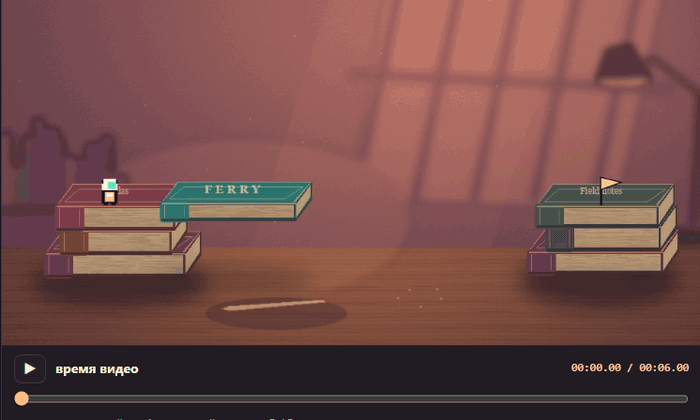

# FRAME FERRY

я тут сделала штуку, которая превращает видео в платформер 💜

**[▶ сразу поиграть](https://kunilika69.github.io/frame-ferry/)** · **[скачать ZIP для офлайна](https://github.com/KuniLika69/frame-ferry/releases/latest/download/frame-ferry.zip)**

смотри: снимаешь, как книга едет от одной стопки к другой. потом прыгаешь на неё и мотаешь видео вперёд. книга везёт тебя к финишу. можно мотать прям в прыжке: предметы уже в другом кадре, а герой ещё в воздухе.

## как попробовать

открой демку по ссылке выше и жми **играть**. «Книга-паром» уже в редакторе. прыгни на книгу, перемотай видео вперёд и прыгни к флажку.

можно и без интернета: скачай ZIP, распакуй его и открой `index.html` в Chrome или Edge.

- **← / →** или **A / D** — ходить, **пробел** — прыгать.
- **Q** мотает видео назад, **E** вперёд. можно и ползунком.
- **R** возвращает героя на старт. на телефоне есть экранные кнопки и ползунок.

## как сделать свой уровень

1. жми **открыть видео** и выбирай свой ролик. для первого раза проще взять короткий MP4, где камера стоит на месте.
2. выбери **платформа** и обведи то, на чём герой будет стоять.
3. если предмет едет, выбери **движущаяся платформа** и обведи его. потом мотни видео и обведи его там, где он оказался. если предмет поворачивает или меняет скорость, добавь ещё пару кадров кнопкой **добавить ключевой кадр**. между кадрами платформа едет по прямой.
4. поставь **старт** и **финиш** по верхнему краю нужных платформ. жми **играть** и пробуй пройти свой уровень)
5. жми **скачать уровень**, чтобы сохранить видео и разметку одним файлом `.ferry`. потом его можно открыть через **открыть видео**. у демо в файл попадёт только разметка. ролик редактор возьмёт из `assets`.

если видео с телефона не открывается, попробуй сохранить его как MP4 с кодеком H.264. форматы, которые откроются, зависят от браузера.

если зашло, поставь звёздочку сверху. мне будет приятно 💜

*Turn your own videos into playable platformer levels. Scrub the video while you play to move the platforms.*
